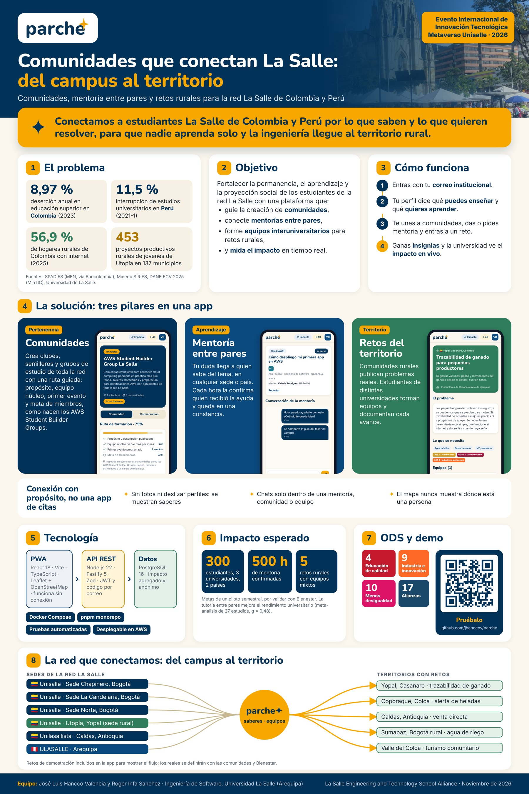

# Parche ✦ Comunidades que conectan La Salle

**Del campus al territorio.** Parche es una aplicación web móvil (PWA) exclusiva para estudiantes verificados de la red La Salle en **Colombia y Perú**. Convierte la conexión entre estudiantes en aprendizaje y en soluciones reales:

| Pilar | Qué hace | Por qué importa |
| --- | --- | --- |
| **Comunidades** | Crear y hacer crecer comunidades estudiantiles (clubes, semilleros, grupos de estudio) con una ruta guiada: propósito, equipo núcleo, primer evento y meta de miembros. | Nacer y sostener una comunidad cuesta. El modelo se inspira en cómo se forman los AWS Student Builder Groups. |
| **Mentoría entre pares** | Pedir ayuda en un tema y que llegue a quien sabe, en cualquier sede o país. Las horas se confirman y quedan en una constancia. | La tutoría entre pares mejora el rendimiento académico (meta-análisis de 27 estudios, efecto g = 0,48). La deserción anual ronda el 9 % en Colombia y el 11,5 % en Perú. |
| **Retos del territorio** | Comunidades rurales publican problemas reales; estudiantes de distintas universidades forman equipos y documentan avances. | Lleva la ingeniería a los territorios rurales, el eje del Evento Internacional de Innovación Tecnológica de la alianza La Salle. |

**No es una app de citas.** No hay fotos ni deslizar perfiles. Cada interacción nace de un propósito (un tema de mentoría, una comunidad o un reto), los chats solo existen dentro de esos espacios y el mapa nunca muestra dónde está una persona.



## Funcionalidades

- Acceso solo con correo institucional (`@unisalle.edu.co`, `@lasalle.edu.co`, `@unilasallista.edu.co`, `@ulasalle.edu.pe`) y código de un solo uso.
- Perfil por saberes: "puedo ayudar en" y "quiero aprender".
- Comunidades con ruta de formación, eventos con confirmación de asistencia, equipo núcleo y chat.
- Mentoría: solicitudes que llegan primero a quien domina el tema, chat privado mentor-estudiante, cierre con horas y calificación.
- Retos del territorio: equipos de hasta 6 personas, marca de equipo interuniversitario, bitácora de avances y chat de equipo.
- Mapa de sedes, comunidades, eventos y retos (Leaflet y OpenStreetMap), con vista "mi sede" y "toda la red".
- Puntos e insignias por colaborar: Mentor, Fundador, Agente de territorio, Puente La Salle y Conector.
- Constancia imprimible de horas de mentoría, confirmadas por quien recibió la ayuda.
- Tablero público de impacto con datos agregados y anónimos para Bienestar Universitario.
- Reportes de contenido y moderación.
- PWA instalable con caché sin conexión.
- Campus 3D Arequipa (`/campus`): maqueta 3D navegable de ULASALLE con three.js, con lugares que conectan con Parche. Se carga aparte (lazy) para no pesar en el resto de la app.
- La Salle hoy: prioriza Arequipa, luego Colombia y México (pestañas por región y "Redes oficiales" con el Facebook de ULASALLE cargado con un toque mediante el plugin oficial de página, más enlaces a Instagram ulasalleperu, Unisalle y La Salle México; `GET /api/news/socials`). Solo contenido oficial de la red La Salle del mundo: noticias de lasalle.org y de universidades La Salle (Filadelfia, Manila, Bogotá, Barcelona) por su API de WordPress o RSS, y videos de sus canales de YouTube. Si ninguna fuente responde, muestra destacados de la red con enlaces reales. Estado de las fuentes en `/api/news/status`. Fuentes gratuitas y sin claves, caché de 45 minutos, temas y orden según lo que el estudiante quiere aprender; siempre enlaza a la publicación original. Se agregan fuentes desde Render con `NEWS_YOUTUBE_CHANNELS` y `NEWS_EXTRA_FEEDS`.
- Asistente Juanita: chat de ayuda con la mascota de La Salle Bogotá que responde dudas y lleva a la pantalla correcta. Funciona en modo guía sin claves y con IA (Claude) si se configura `ANTHROPIC_API_KEY`; si la IA falla, vuelve sola al modo guía.
- Consentimiento informado al entrar, política de privacidad pública (`/privacidad`) y opción de eliminar la cuenta, conforme a la Ley N.° 29733 (Perú) y la Ley 1581 de 2012 (Colombia).

## Arquitectura

```
apps/
  api/   Node.js 22 + TypeScript + Fastify 5 + PostgreSQL 16 (SQL directo, Zod, JWT)
  web/   React 18 + Vite + TypeScript + PWA (Workbox) + Leaflet
docker-compose.yml   db (Postgres) + api + web (Nginx)
```

Más detalle en [`docs/arquitectura.md`](docs/arquitectura.md).

## Puesta en marcha

### Con Docker (recomendado)

```bash
cp .env.example .env
docker compose up --build
```

- App: http://localhost:8080
- API: http://localhost:4000/api/health

En modo demostración (`DEMO_MODE=true`) se cargan datos de ejemplo y la pantalla de entrada ofrece usuarios demo. El código de acceso se muestra en pantalla si no hay SMTP configurado.

### En desarrollo con pnpm

Requisitos: Node.js 20+, pnpm 10 y PostgreSQL 16.

```bash
pnpm install
docker compose up -d db          # o tu propio Postgres
cp .env.example .env
pnpm db:seed                     # migra y carga datos de demostración
pnpm dev                         # API en :4000 y web en :5173
```

### Pruebas

```bash
createdb parche_test             # base de datos de pruebas
pnpm test                        # 16 pruebas de integración de la API
```

### Publicar en internet (Render)

El `Dockerfile` de la raíz arma una sola imagen: la API sirve también la app web. El archivo `render.yaml` crea el servicio y la base de datos.

1. Entra a https://render.com con tu cuenta de GitHub.
2. New > Blueprint > elige este repositorio > Apply.
3. Los planes gratis de Render bloquean el correo SMTP, así que los códigos se envían con la API de Brevo (gratis, 300 correos al día). En https://brevo.com crea una cuenta, verifica tu correo remitente y genera una API key. En el servicio `parche`, pestaña Environment, define `BREVO_API_KEY` y `MAIL_FROM` (por ejemplo `Parche <tucorreo@gmail.com>`, con el mismo correo verificado). En un plan pagado también puedes usar `SMTP_URL`.
4. Opcional, más fuentes para La Salle hoy: en Environment define `NEWS_YOUTUBE_CHANNELS` con el formato `Nombre|ID_DEL_CANAL; Otro|ID` (el ID empieza con `UC`) y `NEWS_EXTRA_FEEDS` con `Nombre|https://sitio/feed/; Otro|https://otro/rss.xml`. Las que no respondan no se muestran. Detalle de todas las fuentes y redes en [docs/fuentes-la-salle-hoy.md](docs/fuentes-la-salle-hoy.md). Para sumar una región al final pon `|arequipa`, `|colombia` o `|mexico`. Más redes oficiales con `NEWS_SOCIAL_PAGES` = `region|red|Nombre|https://url` (por ejemplo `mexico|facebook|La Salle México|https://www.facebook.com/pagina`).
5. Opcional, asistente con IA: en https://console.anthropic.com crea una clave de API y en Environment define `ANTHROPIC_API_KEY` (y si quieres `ANTHROPIC_MODEL`, por defecto `claude-haiku-5-5`). Sin clave, Juanita responde en modo guía.
6. Comparte la dirección `https://parche-xxxx.onrender.com` que muestra Render.

## Feria Concurso de Proyectos Digitales 2026 (ULASALLE)

Parche también se presenta a la Feria Concurso "Apps que transforman mi comunidad" de la Escuela de Ingeniería de Software (19 de noviembre de 2026, auditorio Benito), categoría A.

| Requisito de las bases | Cómo lo cumple Parche |
| --- | --- |
| Comunidad concreta y problema delimitado | Estudiantes de ULASALLE Arequipa y de la red La Salle en Colombia: aprender solos, no encontrar a quién preguntar y abandonar. Evidencias en [`docs/propuesta-de-valor.md`](docs/propuesta-de-valor.md) y fotos de la Misión Académica Colombia 2026. |
| Eje temático | Educación y alfabetización digital, con retos de turismo, agua y agro en territorios rurales. |
| MVP demostrable en vivo | https://parche-bokw.onrender.com (modo demostración con usuarios de ejemplo). |
| Repositorio con aportes de todo el equipo | Este repositorio, con commits de ambos integrantes. |
| Ley N.° 29733 y consentimiento | Casilla de consentimiento obligatoria, política en `/privacidad` y eliminación de cuenta. Ver [`docs/privacidad-y-seguridad.md`](docs/privacidad-y-seguridad.md). |
| Pruebas | 16 pruebas de integración de la API (`pnpm test`). |

Detalle por criterio de la rúbrica y guion de la demostración en [`docs/feria-2026.md`](docs/feria-2026.md).

**Uso de herramientas de IA y librerías.** El equipo usó Claude (Anthropic) como asistente de programación y redacción, lo que se ve en el historial del repositorio. Librerías principales: React, Vite, Fastify, Zod, Leaflet, Workbox y lucide-react. Las fotos son propias de la delegación ([`docs/creditos-imagenes.md`](docs/creditos-imagenes.md)).

## Documentos de la entrega

- [`docs/entrega/Parche_Poster.jpg`](docs/entrega/Parche_Poster.jpg): póster en alta resolución (3600 x 5400 px)
- [`docs/entrega/Parche_Resumen_Ejecutivo.docx`](docs/entrega/Parche_Resumen_Ejecutivo.docx): resumen ejecutivo (5 páginas)
- [`docs/entrega/Parche_Presentacion.pptx`](docs/entrega/Parche_Presentacion.pptx): presentación (10 láminas)

## Documentación

- [`docs/propuesta-de-valor.md`](docs/propuesta-de-valor.md): problema, solución, impacto y diferenciales
- [`docs/arquitectura.md`](docs/arquitectura.md): componentes, modelo de datos y API
- [`docs/impacto-y-metricas.md`](docs/impacto-y-metricas.md): indicadores y metas del piloto
- [`docs/despliegue-aws.md`](docs/despliegue-aws.md): cómo desplegar en AWS
- [`docs/privacidad-y-seguridad.md`](docs/privacidad-y-seguridad.md): datos personales y protección
- [`docs/feria-2026.md`](docs/feria-2026.md): alineación con las bases y la rúbrica de la Feria Concurso 2026

## Equipo

| Integrante | Rol | GitHub |
| --- | --- | --- |
| José Luis Hancco Valencia | Líder del proyecto, propuesta de valor y desarrollo | [@jhanccov](https://github.com/jhanccov) |
| Roger Infa Sanchez | Desarrollo full stack e identidad visual | [@rogerinfas](https://github.com/rogerinfas) |

Estudiantes de Ingeniería de Software de la Universidad La Salle (Arequipa, Perú), en colaboración con la red La Salle de Colombia. Proyecto para el Evento Internacional de Innovación Tecnológica de La Salle Engineering and Technology School Alliance y para la Feria Concurso de Proyectos Digitales 2026 de ULASALLE (noviembre de 2026).

Los retos y usuarios incluidos en los datos de demostración son ejemplos ilustrativos.
