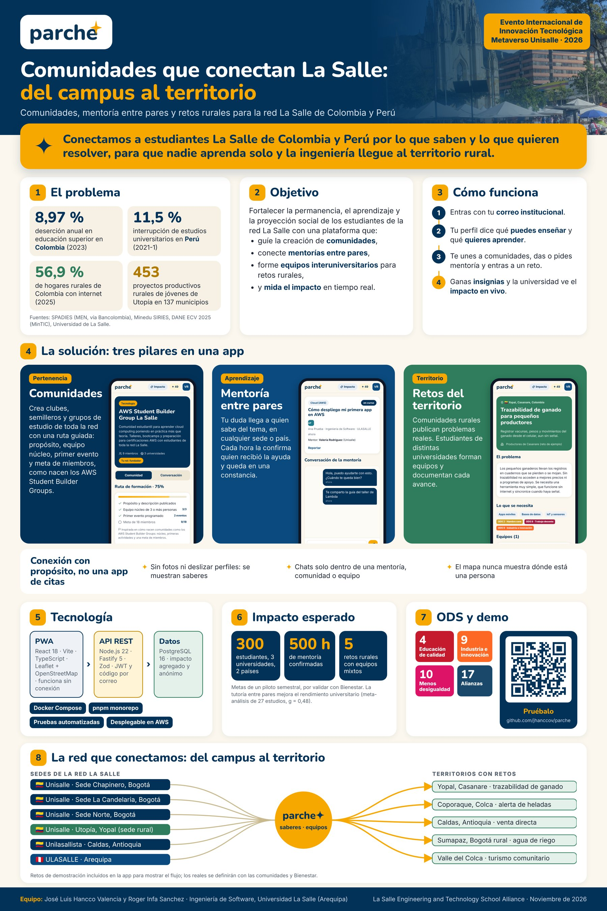

# Parche ✦ Comunidades que conectan La Salle

**Del campus al territorio.** Parche es una aplicación web móvil (PWA) exclusiva para estudiantes verificados de la red La Salle en **Colombia y Perú**. Convierte la conexión entre estudiantes en aprendizaje y en soluciones reales:

| Pilar | Qué hace | Por qué importa |
| --- | --- | --- |
| **Comunidades** | Crear y hacer crecer comunidades estudiantiles (clubes, semilleros, grupos de estudio) con una ruta guiada: propósito, equipo núcleo, primer evento y meta de miembros. | Nacer y sostener una comunidad cuesta. El modelo se inspira en cómo se forman los AWS Student Builder Groups. |
| **Mentoría entre pares** | Pedir ayuda en un tema y que llegue a quien sabe, en cualquier sede o país. Las horas se confirman y quedan en una constancia. | La tutoría entre pares mejora el rendimiento académico (meta-análisis de 27 estudios, efecto g = 0,48). La deserción anual ronda el 9 % en Colombia y el 11,5 % en Perú. |
| **Retos del territorio** | Comunidades rurales publican problemas reales; estudiantes de distintas universidades forman equipos y documentan avances. | Lleva la ingeniería a los territorios rurales, el eje del Evento Internacional de Innovación Tecnológica de la alianza La Salle. |

**No es una app de citas.** No hay fotos ni deslizar perfiles. Cada interacción nace de un propósito (un tema de mentoría, una comunidad o un reto), los chats solo existen dentro de esos espacios y el mapa nunca muestra dónde está una persona.



## Funcionalidades

- Acceso solo con correo institucional (`@unisalle.edu.co`, `@lasalle.edu.co`, `@unilasallista.edu.co`, `@ulasalle.edu.pe`) y código de un solo uso.
- Perfil por saberes: "puedo ayudar en" y "quiero aprender".
- Comunidades con ruta de formación, eventos con confirmación de asistencia, equipo núcleo y chat.
- Mentoría: solicitudes que llegan primero a quien domina el tema, chat privado mentor-estudiante, cierre con horas y calificación.
- Retos del territorio: equipos de hasta 6 personas, marca de equipo interuniversitario, bitácora de avances y chat de equipo.
- Mapa de sedes, comunidades, eventos y retos (Leaflet y OpenStreetMap), con vista "mi sede" y "toda la red".
- Puntos e insignias por colaborar: Mentor, Fundador, Agente de territorio, Puente La Salle y Conector.
- Constancia imprimible de horas de mentoría, confirmadas por quien recibió la ayuda.
- Tablero público de impacto con datos agregados y anónimos para Bienestar Universitario.
- Reportes de contenido y moderación.
- PWA instalable con caché sin conexión.

## Arquitectura

```
apps/
  api/   Node.js 22 + TypeScript + Fastify 5 + PostgreSQL 16 (SQL directo, Zod, JWT)
  web/   React 18 + Vite + TypeScript + PWA (Workbox) + Leaflet
docker-compose.yml   db (Postgres) + api + web (Nginx)
```

Más detalle en [`docs/arquitectura.md`](docs/arquitectura.md).

## Puesta en marcha

### Con Docker (recomendado)

```bash
cp .env.example .env
docker compose up --build
```

- App: http://localhost:8080
- API: http://localhost:4000/api/health

En modo demostración (`DEMO_MODE=true`) se cargan datos de ejemplo y la pantalla de entrada ofrece usuarios demo. El código de acceso se muestra en pantalla si no hay SMTP configurado.

### En desarrollo con pnpm

Requisitos: Node.js 20+, pnpm 10 y PostgreSQL 16.

```bash
pnpm install
docker compose up -d db          # o tu propio Postgres
cp .env.example .env
pnpm db:seed                     # migra y carga datos de demostración
pnpm dev                         # API en :4000 y web en :5173
```

### Pruebas

```bash
createdb parche_test             # base de datos de pruebas
pnpm test                        # 9 pruebas de integración de la API
```

## Documentación

- [`docs/propuesta-de-valor.md`](docs/propuesta-de-valor.md): problema, solución, impacto y diferenciales
- [`docs/arquitectura.md`](docs/arquitectura.md): componentes, modelo de datos y API
- [`docs/impacto-y-metricas.md`](docs/impacto-y-metricas.md): indicadores y metas del piloto
- [`docs/despliegue-aws.md`](docs/despliegue-aws.md): cómo desplegar en AWS
- [`docs/privacidad-y-seguridad.md`](docs/privacidad-y-seguridad.md): datos personales y protección

## Equipo

| Integrante | Rol | GitHub |
| --- | --- | --- |
| José Luis Hancco Valencia | Líder del proyecto, propuesta de valor y desarrollo | [@jhanccov](https://github.com/jhanccov) |
| Roger Infa Sanchez | Desarrollo full stack e identidad visual | [@rogerinfas](https://github.com/rogerinfas) |

Estudiantes de Ingeniería de Software de la Universidad La Salle (Arequipa, Perú), en colaboración con la red La Salle de Colombia. Proyecto para el Evento Internacional de Innovación Tecnológica de La Salle Engineering and Technology School Alliance (noviembre de 2026).

Los retos y usuarios incluidos en los datos de demostración son ejemplos ilustrativos.
